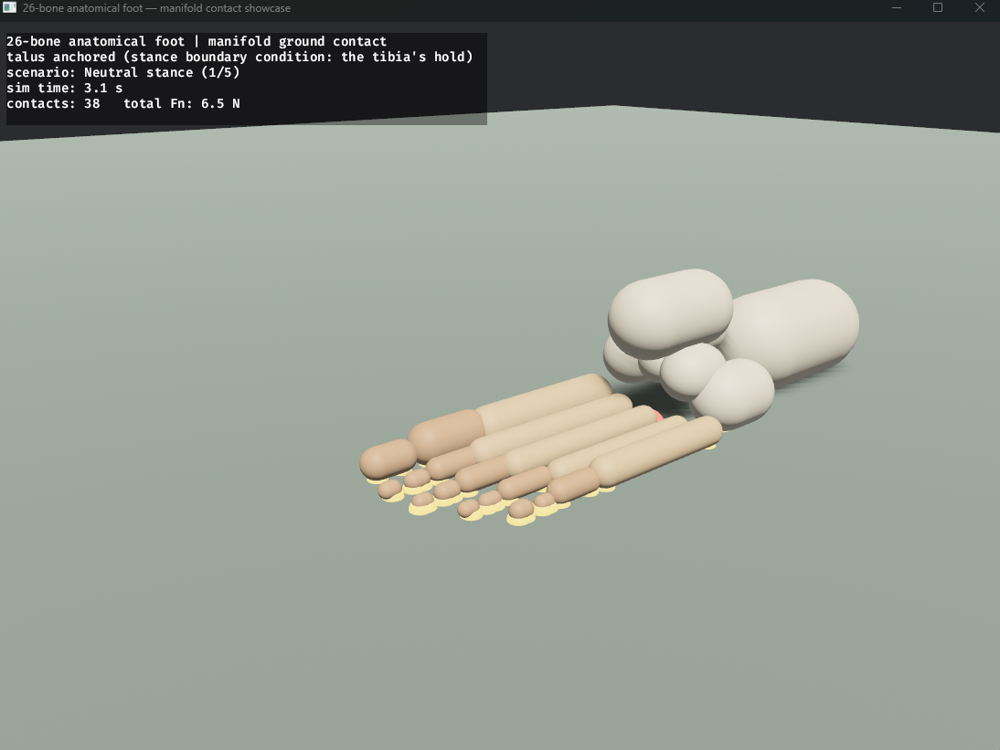

# improper-football




*The 26-bone foot in neutral stance (`foot_anatomical_demo`): live contact
markers across heel, metatarsal heads, and toes; the red dot is the force-
weighted center of pressure. The talus is anchored as the stance boundary
condition (the tibia's hold).*

A biomechanically-grounded human motion physics engine in Rust, built from
first principles on an XPBD (extended position-based dynamics) substrate with
sequential-impulse constraints, implicit integration for stiff components, and
anatomically-faithful joint modeling.

In plain terms: a simulated human skeleton with real bone-by-bone anatomy —
down to a 26-bone foot standing on physically simulated ground contact —
built so that every claim about its behavior is backed by a test you can run.

The long-term goal is a general human-motion simulator that integrates the
best ideas from the leading physics engines — MuJoCo's soft constraints,
Drake's inverse dynamics, Bullet's sequential-impulse contacts, OpenSim's
musculoskeletal fidelity — into one coherent system, applied to (American)
football motion as the driving use case.

## Highlights

**26-bone anatomical foot** (`src/anatomy/foot.rs`) — every tarsal,
metatarsal, and phalanx is a distinct rigid body with literature-sourced
dimensions and mass distribution (Zatsiorsky/de Leva segment data,
osteometric bone studies). 21 articulated joints with anatomically
oriented axes — oblique where the literature says it matters: the subtalar joint uses
Manter/Inman's 42°-inclination, 23°-medial-deviation axis (the mechanism
behind inversion ankle sprains) and the Chopart pair carry their oblique
axes; the remaining joints use their dominant anatomical plane — plus 8
stiff welds for the cadaver-confirmed minimal-motion midfoot joints.
Construction is data-driven: bone and joint parameter tables consumed by
generic builders. Rest placement is an explicit, documented coordinate
table (`REST_POS`), refined against geometry checkpoints rather than
hand-tweaked in place.

**Multi-point manifold ground contact** — ground contact is solved as
simultaneous sequential-impulse non-penetration constraints across all
contacting capsule endpoints (Bullet SI-style, with a Coulomb friction
cone), not independent penalty forces. This was motivated by a measured
failure: independent per-point penalty contact collapsed a rigid foot's
84 cm² footprint to one intermittent contact point (0.39 cm²), so bodies
tipped over instead of standing. With the manifold, the same assembly
stands at 2.3° tilt on 36 simultaneous contacts. The diagnostic that
isolated this (`src/bin/foot_rigid_balance_diag.rs`) is kept and exits
nonzero if the nominal rigid assembly ever stops standing; the CI-level
regression gate for the manifold property is
`manifold_keeps_resting_capsule_level_with_two_active_contacts` in the
engine test suite.

**Stiffness-safe integration** — explicit-Euler force application is
unstable for stiff springs/dampers on small bodies (the foot's 2-gram
distal phalanges violate `dt < 2m/c` by >10×). All springs, dampers, and
soft limits integrate implicitly (backward-Euler velocity solves,
unconditionally stable); joint position coupling and angular locks use
XPBD/SI constraints. The engine survived its hardest test to date: a
28-body assembly spanning a 3500:1 mass ratio (7 kg load stick to 2 g toe
bones) settling stably on the ground.

**Biological constraints always** — every joint constrains every anatomical
axis: primary axis with ROM soft-limits from clinical range-of-motion data,
off-axes locked with physiological slop. Passive stiffness is sized from
published moment-angle data where it exists (Riener & Edrich 1999 for the
talocrural; Heng 2016 for the first MTP) and assigned by analogy elsewhere —
only three foot joints have published curves. ROMs and gains are per-joint
data, not engine-level constants — biological variance is the design.

**Inverse dynamics** (`crates/physics/src/inverse_dynamics.rs`) — per-joint
gravity feedforward G(q) computed each substep and fed to the PD
controllers (Drake/MuJoCo computed-torque style), with fractional load
sharing for closed chains (bilateral stance).

**Regression-tested engine** — `crates/physics/tests/engine_regression.rs`
guards contact behavior, small-body stability, energy boundedness, and the
manifold multi-contact property. Tests were adversarially verified to fail
on revert before being trusted.

## Architecture

```
crates/physics/          The engine (no app dependencies)
  src/xpbd.rs            World, substep loop, SI solver, ground manifold
  src/rigid_body.rs      Capsule bodies
  src/contact_constraint.rs  Unilateral SI contact + friction cone
  src/angular_*.rs       Springs, dampers, soft limits, PD controllers,
                         angular SI constraints (all implicit/SI)
  src/inverse_dynamics.rs    Gravity feedforward G(q)
  tests/engine_regression.rs Engine acceptance suite

src/anatomy/             Reusable anatomical assemblies (data-driven)
  foot.rs                26-bone foot: bone/joint tables + builders

src/bin/                 Validation + visual binaries (one concern each)
  ankle_anatomical.rs    Foot+ankle validation suite (PASS/FAIL, CI-ready)
  foot_rigid_balance_diag.rs Contact-model diagnostic (exits nonzero if the
                         nominal rigid assembly stops standing)
  balance_*.rs, *_demo.rs, ...  Incremental motion milestones
  foot_anatomical_demo.rs  26-bone foot showcase (--loaded for the full-load limit)
```

Physics runs at 120 Hz frames × 60 substeps (sub-dt ≈ 139 µs). Rendering
(Bevy 0.14) is strictly an observer — the engine has no dependency on it.

## Running

```bash
# Engine regression suite + anatomy unit tests
cargo test -p physics
cargo test -p improper-football --lib

# Foot + ankle validation (prints PASS/FAIL, exits nonzero on failure)
cargo run --release --bin ankle_anatomical
cargo run --release --bin ankle_anatomical -- --diagnose   # support-polygon trace

# Contact-model diagnostic (Case 1 must stand; exits nonzero otherwise)
cargo run --release --bin foot_rigid_balance_diag

# Visual demos (Bevy)
cargo run --release --bin foot_anatomical_demo    # 26-bone foot + manifold contact
cargo run --release --bin full_body_demo          # whole-body milestone
cargo run --release --bin balance_bilateral_demo  # shows the current limit of
                                                  # PD-only bilateral balance
```

## Method

The project is built motion-by-motion in small verified increments, with a
spec → plan → implementation → review cycle for each milestone
(`docs/superpowers/specs/`, `docs/superpowers/plans/`; superseded documents
carry historical banners). The diagnosed-root-cause history lives in
[`docs/findings.md`](docs/findings.md). Two principles are enforced
throughout:

- **Diagnose, don't tune.** When something fails, the root cause is isolated
  with a decisive experiment before anything is changed. Example: when the
  foot wouldn't balance, a fully-welded-rigid variant separated "the contact
  model can't form a support base" (true, fixed with manifold contact) from
  "standing needs active control" (false at this stage).
- **Honest scoping.** The anatomy is real but actuation is still placeholder
  PD control; sustained articulated standing awaits the plantar
  fascia/windlass mechanism (Phase 3) and Hill-type muscles (Phase 4). Tests
  assert what the system actually does, not what we wish it did — the
  validation suite's comments document exactly where each limit lies.

## Built with AI, verified by experiment

This project is exploratory research in AI-assisted engineering. I set the
architecture, the biomechanical fidelity bar, and the milestones. Claude
worked inside the requirements as a research partner and implementer, and
every commit is co-authored in the open. What makes the approach trustworthy
is the discipline around it: engine behavior changes are guarded by
regression tests, each verified to fail on revert before being trusted, and
physics claims are only believed after a decisive isolating experiment.
[`docs/findings.md`](docs/findings.md) records what that process caught,
including two of its own wrong conclusions. Rigorous testing, constraints,
and standards are paramount with AI in the loop.

## Roadmap

1. ~~Full-body joint topology with biological constraints~~ (done)
2. ~~Ground contact: world-level ground, manifold multi-point SI contact~~ (done)
3. Plantar fascia / windlass arch stiffening → articulated weight-bearing
4. Hill-type muscle model (force-length/velocity, activation dynamics,
   tendon elasticity) replacing placeholder PDs
5. Proprioception / reflex loops; coordinated whole-body control
6. Sport motion: gait, cutting, jumping — then football.

## License

Licensed under either of

- Apache License, Version 2.0 ([LICENSE-APACHE](LICENSE-APACHE) or
  <http://www.apache.org/licenses/LICENSE-2.0>)
- MIT license ([LICENSE-MIT](LICENSE-MIT) or
  <http://opensource.org/licenses/MIT>)

at your option.

Unless you explicitly state otherwise, any contribution intentionally
submitted for inclusion in this work, as defined in the Apache-2.0 license,
shall be dual licensed as above, without any additional terms or conditions.
